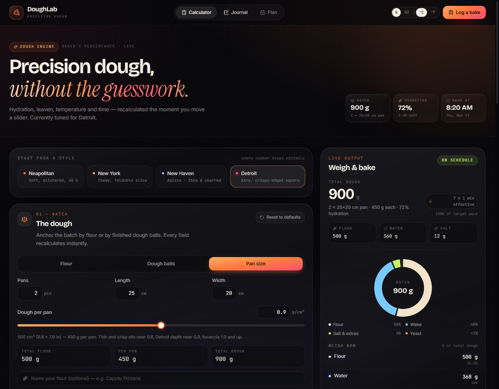
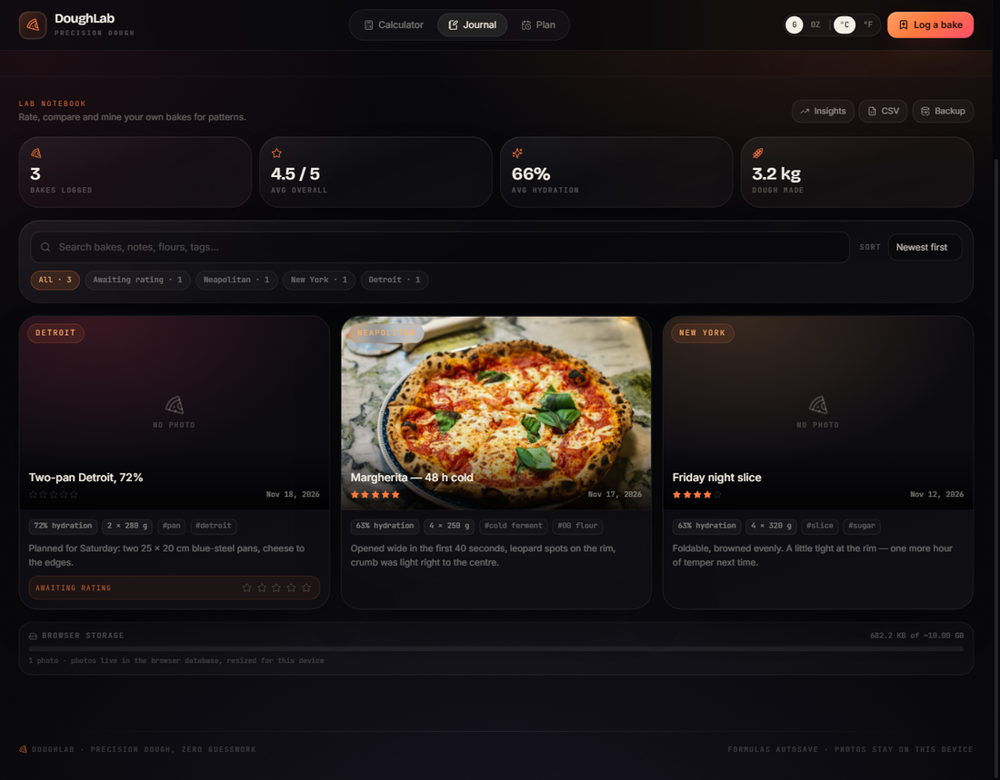
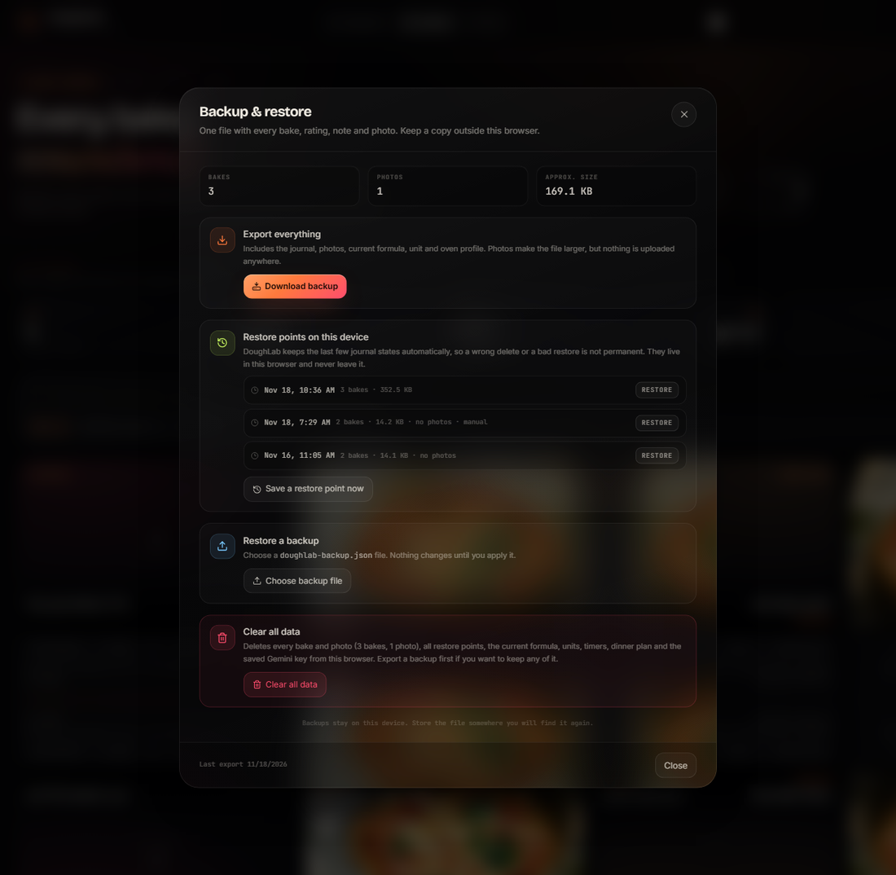
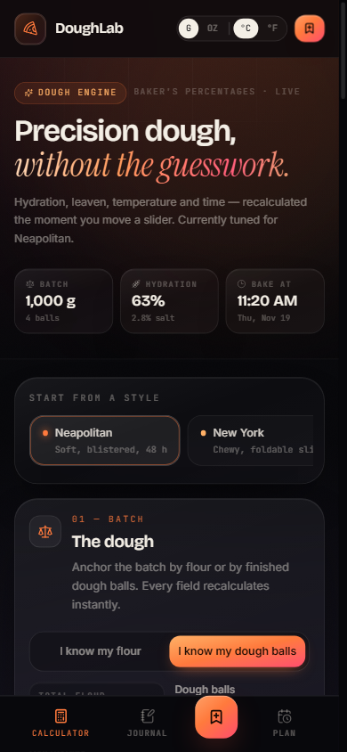
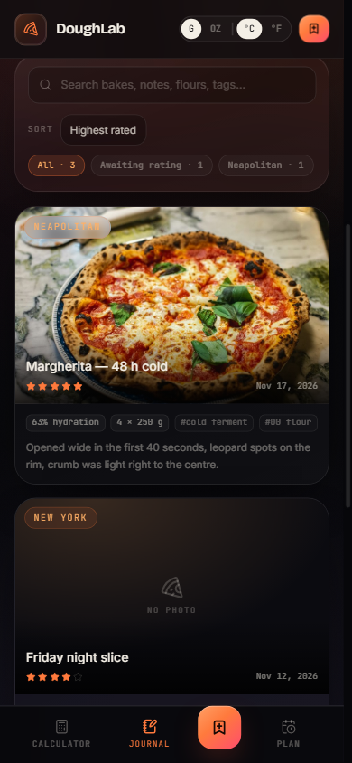
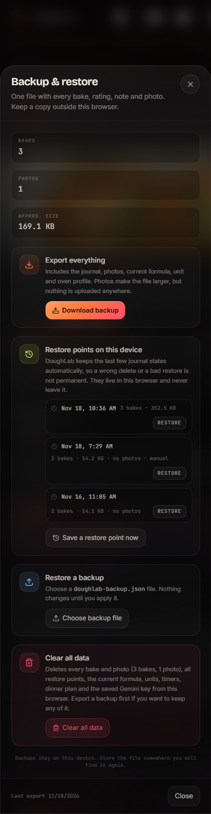
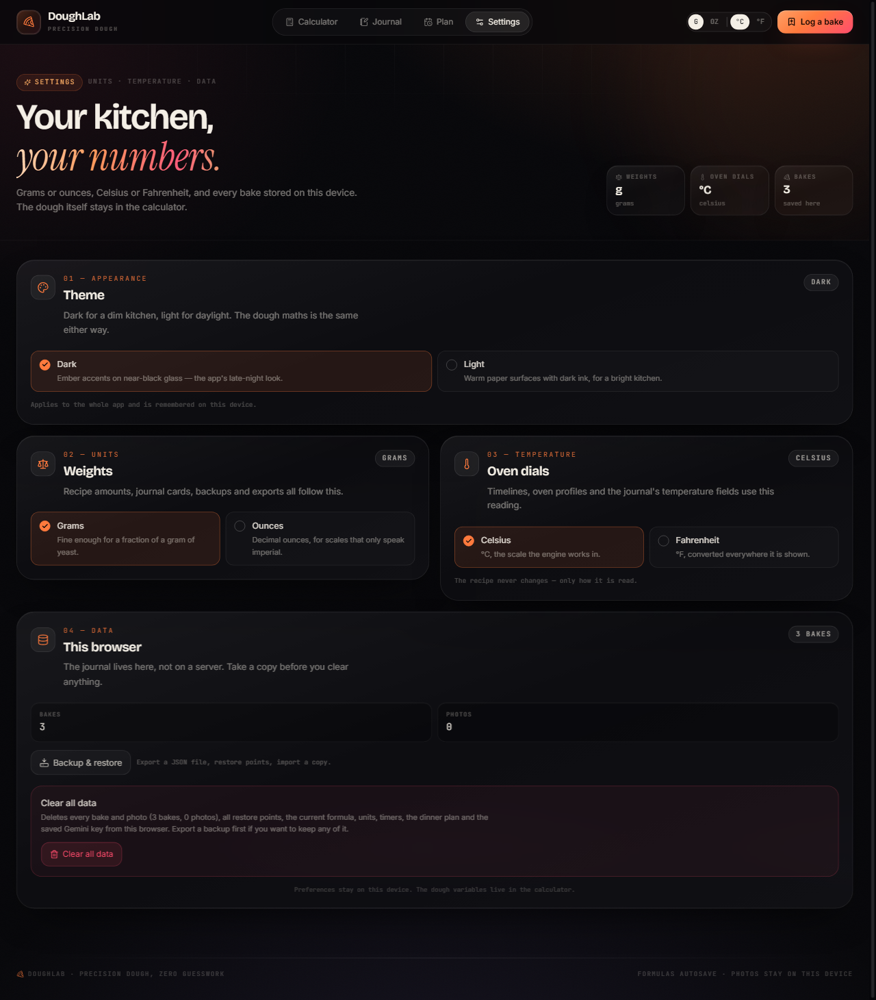
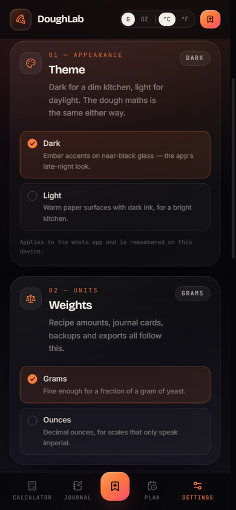
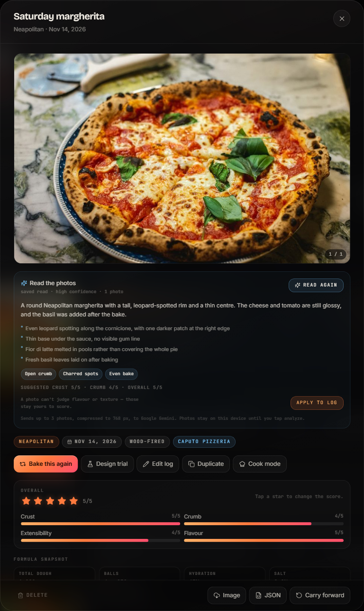

# DoughLab

**[Open DoughLab in your browser →](https://dough-calc-oalmuq.freebuff.page)** — nothing to install,
no account, and every formula and bake stays on your own device.

A local-first pizza dough calculator, bake journal and kitchen timer. Dial in hydration, leavening,
fermentation and oven, log what actually happened, and compare trials. It runs as a static website
(PWA) and as a desktop app for macOS and Windows.

No account, no server and no database: formulas, bakes and photos live in the browser or in the
desktop app's own storage. The only network calls are Google Fonts and, if you add your own Gemini
API key, the AI sommelier / photo reading.

## New here? Start with this

You don't need to understand pizza science to use DoughLab. The app fills in the numbers for you; you
only have to say roughly what you want and press the buttons in order.

### The 60-second version

1. **Open the app** (the website, or the desktop app — they are the same app). On a first visit the
   **New here?** card asks three questions — what you're making, how many, when you mix — and fills
   the calculator in for you.
2. **Pick a style** under **Start from a style** — Neapolitan, New York, New Haven, Detroit… Each card
   loads a complete, sensible recipe for that kind of pizza.
3. **Say how much you're making** with **Dough balls**: 4 balls at 250 g is four 12-inch pizzas.
   Baking in a tray? Switch the sizing mode to **Pan size** and give the pan's length and width
   instead. Not sure? Use the table below.
4. **Leave hydration, salt and yeast alone** for your first bake. The preset is already balanced.
5. **Follow the timeline** at the bottom of the calculator: mix → folds → bulk → ball and fridge →
   temper → preheat → bake. The **Weigh now** list tells you exactly what to put on the scale.
6. **Tap Kitchen mode** when you start cooking: big steps, timers and alarms for someone with floury
   hands.
7. **After eating, tap Save this bake to the journal.** Add a photo, a score and one sentence about
   what happened. That's the habit that makes the next pizza better.

That's it. Everything below is optional detail.

### What it looks like

Real screenshots of the app at desktop (1280 px) and phone (390 px) widths. The four tabs —
**Calculator**, **Journal**, **Plan** and **Settings** — sit in the header on desktop and in the bottom
bar on a phone. The bakes in the journal are example entries, not someone's real dinner.

| **The calculator** | **The journal** | **Backup & restore** |
| --- | --- | --- |
| <a href="docs/screenshots/calculator-desktop.png"></a> | <a href="docs/screenshots/journal-desktop.png"></a> | <a href="docs/screenshots/backup-desktop.png"></a> |
| <a href="docs/screenshots/calculator-phone.png"></a> | <a href="docs/screenshots/journal-phone.png"></a> | <a href="docs/screenshots/backup-phone.png"></a> |
| Pick a style, then size the batch three ways: by flour, by dough balls, or by **pan size** — a pan's length and width plus dough per cm², so a Detroit tray becomes a real weight instead of a guess. **Reset to defaults** sits beside the batch card, and the right-hand panel shows exactly what to weigh. On a phone the same controls stack in order. | Every bake becomes a card with its photo, stars, style, tags and notes. **CSV** and **Backup** sit in the header, the filters narrow by style or by “awaiting rating”, and the storage meter shows what the journal costs in this browser. | One JSON file holds every bake, photo, rating and note. The same panel lists the **restore points** DoughLab keeps by itself and hides **Clear all data** — which also deletes every pizza — behind a second tap. On a phone those sections stack in the same order. |

| **Settings** | **Settings on a phone** |
| --- | --- |
| <a href="docs/screenshots/settings-desktop.png"></a> | <a href="docs/screenshots/settings-phone.png"></a> |

**Settings** gathers the units and oven dials, the backup and restore panel and **Clear all data** in one
place, while every dough variable stays in the calculator.

### What the main screens are for

| Screen | What you do there |
| --- | --- |
| **Calculator** | Choose a style, set how much dough, adjust the recipe, read the weights and the timeline. |
| **Journal** | Every bake you saved: ratings, photos, notes, comparisons, and **Insights** across them. |
| **Plan** | Work backwards from a serve time: how much dough, when to start, oven order — plus a starter build with feed times and amounts. |
| **Settings** | Grams or ounces, Celsius or Fahrenheit, backup and restore, and **Clear all data**. The dough variables stay in the calculator. |
| **Bake Sommelier** (round button, bottom right) | Ask questions about your bakes; optionally attach a photo of one. |

### The only controls you need at first

- **g / oz** and **°C / °F** switch units everywhere — in the header for a quick flip, or on the
  **Settings** tab. Nothing is converted or lost.
- **Sizing** has three modes. **Flour** → start from a bag of flour. **Dough balls** → number of
  pizzas and grams per ball. **Pan size** → the pan's length and width plus **dough per pan**, which
  is what actually sets the depth of a Detroit or focaccia bake.
- **Hydration** = water as a percentage of the flour. 63% means 63 g water per 100 g flour. Higher is
  wetter and airier; lower is easier to handle.
- **Salt** = 2–3% of the flour. 2.5% is the usual pizza level.
- **Leavening** = what makes it rise. **Yeast** is easiest; **Sourdough** and **Pre-ferment** are for
  more flavour and need more time. **Auto dose from the schedule** sets the dose to match your timings.
- **Bulk / Cold retard / Temper** = hours at room temperature, hours in the fridge, hours back at room
  temperature. The app turns these into a start-to-oven timeline.
- **Oven** chips = the heat profile. Pick the one closest to your oven or outdoor oven; the preheat time
  and bake time change with it.

### How much dough per pizza

| Pizza size | Dough per ball |
| --- | --- |
| 10 in / 25 cm | 180–220 g |
| 12 in / 30 cm | 250–280 g |
| 14 in / 35 cm | 330–380 g |
| 16 in / 40 cm | 450–500 g |
| Detroit / pan | 400–500 g per 9×13 in pan |

Rough guide: 2–3 pizzas per adult for a full meal, 1–2 as a starter.

For a pan, the useful number is **dough per square centimetre** rather than per ball: roughly
0.6 g/cm² for a thin, crisp Roman tray, 0.75–0.9 g/cm² for Detroit depth, and 1.0 g/cm² and up for
focaccia. The calculator multiplies by the pan area, so a 25 × 20 cm pan at 0.9 g/cm² asks for a
450 g dough without you doing the arithmetic.

### Words the app uses

| Term | Plain meaning |
| --- | --- |
| **Baker's percentage** | Every ingredient as a % of the flour, so recipes scale cleanly. Flour is always 100%. |
| **Hydration** | Water ÷ flour × 100. The main dial for texture. |
| **Starter** | A living sourdough culture; here assumed 100% hydration (half flour, half water). |
| **Poolish / Biga** | A pre-ferment: part of the flour and water left to ferment before the main mix. |
| **Bulk** | The first rise, before the dough is divided into balls. |
| **Cold retard** | A slow rise in the fridge; builds flavour and makes the dough easier to shape. |
| **Temper** | Letting cold dough warm up before stretching, so it doesn't tear. |
| **Effective hours** | The app's temperature-adjusted fermentation time: fridge hours count for less than room-temperature hours. |
| **On schedule / Brisk / Slow lane** | How your yeast dose compares with what the timings need. “On schedule” means they match. |
| **FDT** | Final dough temperature — the temperature of the dough after mixing, which drives fermentation speed. |

### If something goes wrong

| Problem | First thing to try |
| --- | --- |
| Dough is too sticky to shape | Drop hydration by 2%, or give it 20 more minutes rest and use wet hands. |
| Dough tears when stretching | It's cold or under-rested — let it temper longer. |
| Pale, soft base | Preheat longer and hotter; check the oven profile and give the stone/steel 10 more minutes. |
| Dense, tight crumb | Ferment longer (more bulk or more cold retard), or raise hydration slightly. |
| Gummy centre | Underbaked for its thickness: bake a little longer at the same heat, or thinner. |
| Balls overproofed in the fridge | Shorten the cold retard next time; the journal's **Next time** note is the place to write that down. |

Change **one** thing per bake. The Journal's trial tools are built around that: **Bake this again** copies the
formula, you change a single value, and the comparison shows what actually moved.

## Requirements

| Tool | Version |
| --- | --- |
| Node.js | 20.19+ (22 LTS or newer recommended) |
| npm | 10+ (ships with Node) |

The desktop build additionally needs the platform toolchain described in
[Desktop app](#desktop-app).

## Install

```bash
npm ci
```

`npm ci` installs exactly what `package-lock.json` pins. Use `npm install` only when you intend to
change dependencies.

## Run the website locally

```bash
npm run dev
```

Open http://localhost:3000. The dev server binds to `0.0.0.0`, so a phone on the same Wi-Fi can use
`http://<your-computer-ip>:3000`.

Useful checks:

```bash
npm run typecheck   # TypeScript project build, no emit
npm test            # Vitest unit tests
npm run build       # production build into dist/
```

## Build the website

```bash
npm run build
npm run preview     # optional: serve dist/ locally
```

`npm run build` type-checks and writes a self-contained static site to `dist/` (`index.html`,
hashed JS/CSS, icons, `manifest.webmanifest`, `sw.js`). Because `vite.config.ts` sets
`base: "./"`, the assets work from a domain root or a subdirectory. No SPA rewrite rules are needed —
the app has no client-side router.

Everything in `dist/` is static. Serve it with any web server; HTTPS is required for the service
worker (offline support and install-to-home-screen) on anything other than `localhost`.

### Deployment options

| Option | Build command | Output | Notes |
| --- | --- | --- | --- |
| **Cloudflare Pages** | `npm run build` | `dist` | Set the build command to `npm ci && npm run build`, output directory `dist`. Best with a custom domain or the `*.pages.dev` root. |
| **Netlify** | `npm run build` | `dist` | Connect the repo; build `npm ci && npm run build`, publish directory `dist`. |
| **Vercel** | `npm run build` | `dist` | Import the repo, framework preset **Vite**, output `dist`. |
| **GitHub Pages** | `npm run build` | `dist` | Publish `dist` with an Actions workflow. Use a **user/org site** (`<user>.github.io`) or a custom domain so the app sits at the origin root. |
| **Self-hosted / S3 / nginx** | `npm run build` | `dist` | Copy `dist/` behind any static server or CDN. Serve `index.html` for `/`. |
| **Desktop installers** | see below | `release/` | DMG for macOS, NSIS installer + portable `.exe` for Windows. |

#### Subdirectory caveat

`dist/` uses relative asset paths, so a project page such as
`https://<user>.github.io/dough-lab/` will render correctly. However the PWA pieces use absolute
root paths (`navigator.serviceWorker.register("/sw.js")` in `src/main.tsx`, and `/icon-*.png` /
`start_url: "/"` in `public/manifest.webmanifest`). At a subdirectory those 404, so install and
offline caching do not work. To deploy under a path, either:

1. use an origin root (user site, custom domain, `*.pages.dev`, `*.netlify.app`, `*.vercel.app`), or
2. change the service worker registration and manifest URLs to your subdirectory (and keep
   `base: "./"`).

#### Optional AI configuration

The calculator, journal, timers and exports need no configuration. The AI sommelier and photo
reading need a Google Gemini API key, which can be pasted in the app under **Bake Sommelier → AI
settings** (stored in that browser's `localStorage`).

A build-time key can also be provided, but Vite **inlines** `VITE_*` values into the public bundle,
so anyone can read them:

```bash
VITE_GEMINI_API_KEY="..." VITE_GEMINI_MODEL="gemini-3.8-flash" npm run build
# PowerShell
$env:VITE_GEMINI_API_KEY="..."; npm run build
```

For a public deployment, prefer the in-app key or proxy Gemini through your own backend instead of
shipping a key. Photos are only sent when a user explicitly taps **Analyze** or sends one in the
chat.

## Desktop app

The desktop app is an Electron shell around the same renderer. It adds a native window, a native
photo-folder picker, and a `doughlab-media://` protocol that serves photos from disk. Photos are
written as ordinary files (`doughlab-*.jpg`) into a folder you choose, instead of living inside the
browser database.

The renderer is identical, so build the web assets first — every desktop script below does that for
you except `desktop:dev`.

### Run without packaging

```bash
# Builds dist/ and opens the desktop app against those files (no dev server needed)
npm run desktop

# Development: hot reload from the Vite server
# terminal 1
npm run dev
# terminal 2 — loads http://localhost:3000 by default
npm run desktop:dev
```

To point the desktop window at another dev server, set `DOUGHLAB_DEV_URL`:

```bash
# macOS / Linux
DOUGHLAB_DEV_URL="http://localhost:5173" npm run desktop:dev
```

```powershell
# Windows PowerShell
$env:DOUGHLAB_DEV_URL="http://localhost:5173"; npm run desktop:dev
```

### Package for macOS

Run this **on macOS**; building a DMG needs Apple's tooling.

```bash
npm run desktop:build
```

Output: `release/DoughLab-1.0.0-arm64.dmg` and `release/DoughLab-1.0.0.dmg` (Intel), plus unpacked
apps. The build is **unsigned** on purpose (`mac.identity: null` in `package.json`). On first launch
macOS will refuse the app; open it with **right-click → Open**, or remove the quarantine flag:

```bash
xattr -cr "/Applications/DoughLab.app"
```

If macOS still blocks it, allow it under **System Settings → Privacy & Security → Open Anyway**.
Signing and notarization (Developer ID) are not configured; add them in `package.json` under
`build.mac` if you plan to distribute the app.

### Package for Windows

Run this **on Windows** (NSIS installers built on macOS/Linux require Wine, which is not configured
here).

```bash
npm run desktop:build:win
```

Output in `release/`:

- `DoughLab Setup 1.0.0.exe` — NSIS installer (choose the install directory)
- `DoughLab 1.0.0.exe` — portable single executable

The Windows build is also **unsigned**, so SmartScreen shows “Windows protected your PC” on first
run: **More info → Run anyway**.

The packaging config lives in `package.json` under `build` (`mac`, `win`, `nsis`). Add
`--x64` / `--arm64` to the electron-builder command for other architectures. Linux is not
configured.

### Desktop data locations

| What | macOS | Windows |
| --- | --- | --- |
| App settings (`settings.json`) and journal database | `~/Library/Application Support/DoughLab/` | `%APPDATA%\DoughLab\` |
| Photos | `~/Pictures/DoughLab Photos/` (changeable in the app) | `%USERPROFILE%\Pictures\DoughLab Photos\` (changeable) |

Changing the photo folder copies existing `doughlab-*` files into the new folder so journal
references keep working; the old folder is left untouched. Deleting a bake does not delete its photo
files.

## Project layout

```
src/                 React app (calculator, journal, AI, exports, timers)
src/lib/             Pure logic: dough math, formula, schedule, temperature, vision, storage
src/components/      UI components
electron/            Desktop main process, preload bridge and photo-file helpers
public/              Icons, web manifest, service worker
scripts/             Icon generation
```

## AI features

- **Sommelier chat** — journal-aware answers; you can attach one bake photo per message (from the
  journal or an upload), compressed to 768 px before sending.
- **Saved photo read** — an opt-in Gemini vision pass over up to three photos that proposes outcome
  tags and crust/crumb ratings you can apply to a bake.
- **Diff explanations** — compare two bakes and explain the likely cause of the difference.

All AI features require your own key, run from the client, and never happen without an explicit tap.
See [Optional AI configuration](#optional-ai-configuration) for the cost and key-exposure trade-offs.



*Once you tap Analyze, the saved photo read lists what the model could see, the tags it suggests
and the scores you can apply. Nothing changes on the bake until you tap Apply to log.*

## Everyday tasks

- **Install it like an app (phone or desktop browser):** open the site, then use the browser's *Add to
  Home Screen* / *Install* option. It then opens full-screen and works offline after the first load.
- **Print or share a recipe:** in the calculator, use **Print** for a recipe card, **PNG** for an image,
  **Copy** for text, or **Share** for a link that restores the exact formula.
- **Take it into the kitchen:** **Kitchen mode** shows one large step at a time with timers and alarms;
  the calendar button exports the whole schedule with reminders. The **A+** button enlarges the text
  for reading across the counter, and checked steps survive a reload mid-bake.
- **Be honest about alarms:** browser alarms only ring while the tab is open. **Alarm** on a running
  timer downloads a calendar event the phone itself will fire, even with the screen locked.
- **Keep a backup:** Journal → **Backup** saves one JSON file with every bake and photo. Restore it on
  another computer or after clearing browser data. The same panel lists **restore points** the app
  keeps automatically (the last few journal states), so a wrong delete or a bad restore is undoable.
- **Get the journal into a spreadsheet:** Journal → **CSV** writes one row per bake with formula,
  ratings, tags and notes — handy for asking whether 70% hydration really did score better.
- **Clean up old photos (desktop):** the photo folder card can list images no bake points at any more
  and move them to the Trash. Nothing a bake still uses is ever touched.
- **Build a starter:** Plan → **Build the starter** works backwards from the grams your dough needs to
  feed amounts, feed times and what to keep for next time.
- **Reset the recipe:** **Reset to defaults** at the top of the calculator puts every ratio, leavening
  dose and timing back to the app defaults. The journal is untouched, and the toast offers an Undo.
- **Start over completely:** Journal → **Backup** → **Clear all data** deletes every bake and photo,
  all restore points, the current formula, units, timers, the dinner plan and the saved Gemini key
  from this browser. It asks for a second tap, and it cannot be undone — export a backup first if
  you might want any of it.
- **Move photos into a folder (desktop):** in the Journal you can choose a folder; photos are written
  there as normal image files you can open in Finder or Explorer.
- **Ask the AI:** add a Gemini key in the sommelier's **AI settings**, then ask about a bake or attach a
  photo. Without a key the app still does everything else.

## Troubleshooting

- **`npm run dev` picks a different port** — `strictPort` is off; use the URL Vite prints.
- **Desktop window is blank** — `desktop:dev` needs the Vite server running (or set
  `DOUGHLAB_DEV_URL`); `npm run desktop` builds `dist/` first.
- **Photos show a placeholder in the desktop app** — the photo folder is disconnected or the
  `file:` references were copied without their images. Use the folder picker to reconnect, or restore
  from a JSON backup (backups embed photos).
- **`electron-builder` fails on macOS with a signing error** — the config intentionally has no
  identity; remove any `CSC_*` environment variables you may have set.
- **Journal disappeared after clearing site data** — browser storage was cleared. Export a backup
  regularly from the journal; it restores formulas, bakes and photos. If the data was lost on this
  device without clearing anything, open Journal → **Backup** and check the restore points first.
- **“Browser storage is full”** — the browser refused a write. Export a backup, then remove photos
  from older bakes (or run the photo-folder cleanup in the desktop app) and try again. The journal
  stays in the backup mirror until the database accepts writes again.
- **A pan recipe comes out too shallow or too deep** — change **dough per pan** rather than the
  hydration. Depth is the number that pan baking is actually sensitive to.
